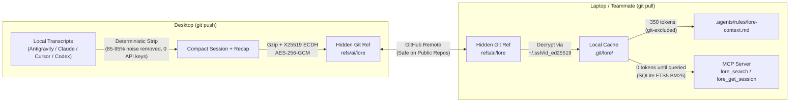

# `lore` (`git-lore`)

**Git-native, encrypted, zero-token-bloat AI context & transcript sync across devices and contributors.**

Switch between your desktop and laptop—or hand off a branch to a teammate—and your AI coding agent (**Antigravity, Claude Code, Cursor, Codex**) immediately knows your past chats, architectural decisions, and debugging context without you ever explaining a thing.

- **0 Cloud Accounts / 0 API Keys**: Uses Git itself (`refs/ai/lore`) as the database and deterministic local compression.
- **~350-Token Always-On Digest + 0-Token Deep Search**: Strips 85–95% of raw `.jsonl` bloat and indexes full transcripts locally via SQLite FTS5 + MCP.
- **Private Context on Public Repos**: Encrypted with your existing `~/.ssh/id_ed25519` key and `https://github.com/<username>.keys` via **Ed25519 → X25519 ECDH + AES-256-GCM**.
- **Zero Git Pollution**: Never touches your working tree, never clutters `git log`, and keeps `git status` 100% clean.

---

## Quick Start (2 Commands)

```bash
# 1. One-time machine setup (registers global MCP server & skill for Antigravity, Claude Code, Cursor)
npx git-lore setup

# 2. Initialize in any Git repository
git lore init
```

From that moment on, every `git push` automatically compresses, encrypts, and syncs your repo's AI sessions to `refs/ai/lore`, and every `git pull` decrypts and updates the local context rule.

---

## How `lore` Compares

| Feature | Static `CLAUDE.md` / `.cursorrules` | Raw Chat Loggers (SpecStory, etc.) | Cloud Memory SaaS (Mem0, etc.) | **`git-lore` (`lore`)** |
| :--- | :--- | :--- | :--- | :--- |
| **Updates automatically on `git push`** | ❌ Manual | ⚠️ Commits giant files to branch | ❌ Separate cloud sync | ✅ **Auto `pre-push` & `post-merge` hooks** |
| **Token cost per chat** | ~500 tokens | ❌ 20,000–100,000+ tokens | Varies | ✅ **~350 tokens (digest) + 0-token FTS5 search** |
| **Safe on public GitHub repos** | ❌ Public to everyone | ❌ Leaks private prompts in PRs | ✅ Private account | ✅ **Encrypted via GitHub SSH keys (`refs/ai/lore`)** |
| **Keeps `git log` & PRs clean** | ⚠️ Manual commits | ❌ Pollutes every PR | ✅ Yes | ✅ **Hidden Git ref (`refs/ai/lore`)** |
| **Requires API key or paid server** | ❌ No | ❌ No | ❌ Yes | ✅ **0 API keys, 100% free & serverless** |

---

## Architecture



---

## Private Context on Public Repos (`git lore allow`)

Because Git allows anyone who clones a public repo to inspect its refs, `lore` encrypts every session and takeaway using **multi-recipient envelope encryption** (`ssh-ed25519-x25519-aes256gcm`):

1. Each payload is compressed with `gzip` and encrypted with a random 256-bit Content Encryption Key (CEK) via `AES-256-GCM`.
2. Each authorized contributor's `ssh-ed25519` public key is converted to Montgomery `X25519` to wrap the CEK via ECDH + `HKDF-SHA256`.
3. To approve a teammate on a public or private repo, run:
   ```bash
   git lore allow torvalds
   ```
   `lore` automatically fetches their public `ssh-ed25519` key(s) from `https://github.com/torvalds.keys` and re-encrypts `refs/ai/lore`.
4. To revoke a contributor and rotate encryption keys:
   ```bash
   git lore revoke torvalds
   ```

---

## CLI Reference

You can run commands as either `lore <cmd>` or native Git subcommand `git lore <cmd>`:

| Command | Description |
| :--- | :--- |
| `lore setup` | One-time global install for Antigravity (`~/.gemini/config/`), Claude Code (`~/.claude.json`), and Cursor (`~/.cursor/mcp.json`) |
| `lore init` | Initialize `lore` in the current Git repo (installs `pre-push` & `post-merge` hooks, authorizes your local SSH key, syncs chats) |
| `lore status` | View synced sessions, compression ratio, takeaways, and authorized SSH keys |
| `lore sync` / `lore push` | Collect local transcripts, encrypt, union-merge with remote `refs/ai/lore`, and push |
| `lore pull` | Fetch & decrypt `refs/ai/lore` from `origin` and refresh `.agents/rules/lore-context.md` |
| `lore allow <github-user>` | Authorize a GitHub user (fetches `github.com/<user>.keys`) or raw `"ssh-ed25519 AAAAC3..."` key |
| `lore revoke <user\|fp>` | Remove a recipient and rotate encryption keys on `refs/ai/lore` |
| `lore note "<text>"` | Save an architectural decision, gotcha, convention, or WIP note (`--cat decision\|architecture\|gotcha\|wip\|convention`) |
| `lore search <query>` | Instant SQLite FTS5 BM25 search across all past sessions and takeaways |
| `lore show <session-id>` | Read the stripped User/Assistant conversation turns of a session in your terminal |

---

## MCP Tools Exposed to Your Agent

Once `lore setup` is run, your AI agents automatically have access to:
*   `lore_status` — View the repo's Living Digest, recent cross-device sessions, and authorized contributors.
*   `lore_search` — Full-text BM25 search across all past transcripts and takeaways in the repo (0 token cost until searched).
*   `lore_get_session` — Retrieve the verbatim User/Assistant dialogue of any past session by ID or prefix.
*   `lore_save_takeaway` — Record an architectural decision, gotcha, or WIP handoff note into the Living Digest.
*   `lore_sync` — Pull and push encrypted context via `refs/ai/lore`.

---

## License

MIT
