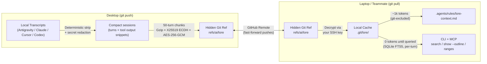

# `lore` (`git-lore`)

[](https://www.npmjs.com/package/git-lore-cli)
[](https://github.com/razamalik7/lore/actions/workflows/publish.yml)
[](./LICENSE)

**Git-native, encrypted AI context & transcript sync across tools, devices, and contributors.**

Switch from Antigravity to Claude Code, from your desktop to your laptop, or hand a branch to a teammate, and the next AI agent (**Antigravity, Claude Code, Cursor, Codex**) can read what was said, decided, and tried before, without you re-explaining it.

<p align="center">
  
</p>

- **No cloud account, no API keys**: Git itself (`refs/ai/lore`) is the database, and compression is deterministic and local.
- **Small always-on digest, deep search on demand**: about 1,000 tokens of takeaways and recent-session recaps in `.agents/rules/lore-context.md`; full transcripts are searchable (SQLite FTS5) and readable turn by turn, costing tokens only when an agent asks.
- **Private context on public repos**: encrypted to your existing `ssh-ed25519` keys and `github.com/<user>.keys` (Ed25519 → X25519 ECDH + AES-256-GCM), with secrets redacted before anything is stored.
- **No Git pollution**: never touches your working tree, `git log`, or `git status`.

---

## Quick Start

```bash
# 1. One-time machine setup: MCP server + agent instructions for Antigravity, Claude Code, Cursor, Codex
npm i -g git-lore-cli
lore setup                # add --handoff to start Claude Code sessions with recent work from other tools

# 2. In any Git repository
git lore init
```

From then on, every `git push` collects, compresses, encrypts, and syncs the repo's AI sessions to `refs/ai/lore`, and every `git pull` brings in other devices' sessions and refreshes the digest.

Requires Node.js 22.5+. Prefer a global install over `npx`: `lore setup` points agents and git hooks at the global install, because npx's cache can be cleared at any time.

---

## Picking Up Work From Another Tool

The digest tells an agent *what* happened recently. For the details:

```bash
lore show a1b2c3d4 --outline           # one line per user prompt, with turn numbers
lore show a1b2c3d4 --from 180 --to 200 # read the stretch that matters
lore show a1b2c3d4 --last 20           # or just the end
lore search "outline width equalization"
#   • [SESSION] Art style review (id: a1b2c3d4 …)
#     Turns  : #187, #191  →  lore show a1b2c3d4 --from 184 --to 193
```

- **Long sessions:** decisions usually live in the middle, not at the end. Over MCP, `lore_get_session` on a long session returns the outline plus the last 20 turns by default, and takes `outline`, `last`, `from`, and `to`.
- **Evidence:** each turn keeps short snippets of the command output and errors behind the reply (secrets redacted; file reads skipped), so agents see results, not just "ran the tests".
- **Handoff hook (opt-in):** `lore setup --handoff` adds a Claude Code SessionStart hook. When the most recent work in a repo (within 24 hours) was in another tool, the session starts with a short note: what it was, the last prompts and reply, and the exact `lore show` commands to read more. `lore handoff` prints the same note on demand; `lore setup --no-handoff` turns it off.
- **Takeaways:** `lore note "<1-3 sentences, including why>" --cat decision|gotcha|convention|architecture|wip` records the distilled knowledge the next agent relies on most. Claude Code memory files (`~/.claude/projects/<repo>/memory/*.md`) are imported as takeaways automatically.

`lore setup` installs instructions telling each agent when to do all of this: read the other tool's session before continuing, use the outline for long sessions, save takeaways at decisions and gotchas, and treat old transcripts as history rather than instructions. They go into the Antigravity skill (`~/.gemini/config/skills/lore/SKILL.md`), `~/.claude/CLAUDE.md`, and (when Codex is installed) `~/.codex/AGENTS.md`. Cursor gets the MCP server.

---

## How `lore` Compares

| Feature | Static `CLAUDE.md` / `.cursorrules` | Raw Chat Loggers (SpecStory, etc.) | Cloud Memory SaaS (Mem0, etc.) | **`git-lore` (`lore`)** |
| :--- | :--- | :--- | :--- | :--- |
| **Updates automatically on `git push`** | ❌ Manual | ⚠️ Commits giant files to branch | ❌ Separate cloud sync | ✅ **Auto `pre-push` & `post-merge` hooks** |
| **Token cost per chat** | ~500 tokens | ❌ 20,000–100,000+ tokens | Varies | ✅ **~1k-token digest; transcripts only when asked** |
| **Read any stretch of a past session** | ❌ | ⚠️ Whole files | ⚠️ Summaries | ✅ **Outline + turn ranges + turn-level search** |
| **Safe on public GitHub repos** | ❌ Public to everyone | ❌ Leaks private prompts in PRs | ✅ Private account | ✅ **Encrypted via GitHub SSH keys (`refs/ai/lore`)** |
| **Keeps `git log` & PRs clean** | ⚠️ Manual commits | ❌ Pollutes every PR | ✅ Yes | ✅ **Hidden Git ref (`refs/ai/lore`)** |
| **Requires API key or paid server** | ❌ No | ❌ No | ❌ Yes | ✅ **0 API keys, 100% free & serverless** |

---

## Architecture



### Which sessions belong to a repo

- **Claude Code / Cursor:** sessions from the tool's project folder for that repo (and its worktrees). `lore` matches folder names exactly, so `lore` never picks up `lore-site`.
- **Antigravity:** conversations whose workspace is the repo; or, when the workspace is a parent folder (like `~/Projects`), conversations that actually read or edited files or ran commands inside the repo. A conversation rooted in a *different* repo is never included just because its logs mention this one.
- **Codex:** sessions whose working directory is inside the repo.
- **Cleanup:** `lore forget --check` lists sessions an older version filed in the wrong repo; `lore forget <ids>` removes them.

### How syncing works

- Before pushing, `lore` fetches the remote ref, merges its sessions, takeaways, and keys into the local cache, and commits on top of the remote commit. Pushes are plain fast-forwards; if another device pushed in between, it merges again and retries. Only `lore compact` force-pushes, and it uses an explicit lease.
- Each session is stored as a small `meta.enc` plus fixed 50-turn chunks (`s2/<id>/c0000.enc`, …). Unchanged payloads reuse their existing encrypted blobs, so a sync only stores what changed and a growing session only rewrites its last chunk. A sync with no changes makes no commit.
- Sessions keep the branch and commit they were first seen on.
- Deletions (`lore forget`) are recorded as tombstones inside the encrypted data, so other devices drop the item on their next sync instead of merging it back.

---

## Privacy & Security

### Encryption (`git lore allow`)

Anyone who clones a public repo can fetch its refs, so `lore` encrypts every session and takeaway with **multi-recipient envelope encryption** (`ssh-ed25519-x25519-aes256gcm`):

1. Each payload is gzipped and encrypted with a random 256-bit key via `AES-256-GCM`.
2. That key is wrapped for each authorized `ssh-ed25519` public key (converted to X25519) via ECDH + `HKDF-SHA256`.
3. Approve a teammate: `git lore allow torvalds` fetches their keys from `https://github.com/torvalds.keys` and re-encrypts.
4. Revoke: `git lore revoke torvalds` removes their keys and re-encrypts. The revocation is recorded, so merging another device's key list doesn't bring them back. They keep whatever they already fetched; run `lore compact` so new clones of the remote don't contain old encrypted history.

Only `manifest.json` (public keys, revocations, data format) is readable without a key.

### Secret redaction

Before anything is cached or encrypted, `lore` redacts:

- **Known key formats:** GitHub, OpenAI/Anthropic (`sk-…`), Google (`AIza…` and the newer `AQ.…`), AWS, Slack, npm, Hugging Face, JWTs, Bearer tokens, private key blocks (including cut-off ones), and passwords in URLs.
- **Keys in context, whatever the format:** values after names like `API_KEY=`, `SECRET:`, `setx GEMINI_API_KEY …`, and after words like "key:", "my token is", or "password -" in plain chat. Only credential-looking values (letters and digits, long enough, not placeholders or paths) are redacted, so text like "tokens: 247,000,000" stays readable.
- **Where:** message text, titles, recaps, tool summaries, tool-output snippets, and takeaways.

Every sync re-applies the current rules to everything already stored, including sessions imported from other devices, so improvements to redaction clean older data automatically. To purge older copies from the remote's history too, run `lore compact`. Delete `.git/lore/search.db` if you want the local search index rebuilt from scratch.

Redaction is a safety net, not a guarantee: if you paste a key into an AI chat, rotate it.

---

## CLI Reference

Run commands as `lore <cmd>` or `git lore <cmd>`:

| Command | Description |
| :--- | :--- |
| `lore setup` | One-time global install: MCP server + instructions for Antigravity, Claude Code, Claude Desktop, Cursor, Codex. Points them at the global npm install (`--use-this-copy` to use the running copy instead, for developing lore) |
| `lore setup --handoff` / `--no-handoff` | Turn the Claude Code handoff hook on or off |
| `lore init` | Initialize `lore` in the current repo (installs `pre-push` & `post-merge` hooks, authorizes your SSH key, syncs) |
| `lore status` | Synced sessions, compression, takeaways (with ids), authorized keys, and the last git-hook result. Also re-points stale hooks |
| `lore sync` / `lore push` | Collect local transcripts, merge with the remote, encrypt, and push |
| `lore pull` | Fetch & decrypt `refs/ai/lore` and refresh `.agents/rules/lore-context.md` |
| `lore search <query>` | Full-text search across sessions and takeaways, with matching turn numbers |
| `lore show <id>` | Read a session's User/Assistant turns, tool summaries, and output snippets |
| `lore show <id> --outline` | One line per user prompt with its turn number |
| `lore show <id> --last N` / `--from A --to B` | Read only a stretch of turns |
| `lore handoff` | Show recent work from another tool in this repo (what the handoff hook injects) |
| `lore note "<text>" --cat <type>` | Save a takeaway: `decision`, `architecture`, `gotcha`, `convention`, or `wip` |
| `lore forget <id> [...]` | Delete sessions or takeaways by id or prefix, on every device after sync |
| `lore forget --check` | List sessions from this device that no longer belong to this repo |
| `lore compact` | Rewrite `refs/ai/lore` as a single commit, purging old history (forgotten, revoked, or since-redacted data) from the remote |
| `lore allow <github-user \| "ssh-ed25519 …">` | Authorize a contributor |
| `lore revoke <user \| fingerprint>` | Remove a contributor and re-encrypt |

---

## MCP Tools Exposed to Your Agent

After `lore setup`, agents can call:

- `lore_status` — the repo's digest, recent sessions across tools and devices, and authorized keys.
- `lore_search` — full-text search across sessions and takeaways, including matching turn numbers.
- `lore_get_session` — a session's turns by id or prefix. Long sessions return an outline plus the last 20 turns; pass `outline`, `last`, or `from`/`to` for a specific stretch.
- `lore_save_takeaway` — record a decision, gotcha, convention, or WIP note.
- `lore_sync` — pull and push the encrypted context.

---

## Upgrading & Compatibility

Every device that syncs a repo reads and writes the same `refs/ai/lore`, so **upgrade all your machines together**:

```bash
npm i -g git-lore-cli@latest && lore setup
```

| Your version | Reading data from a newer version |
| :--- | :--- |
| 0.2.x | Reads format 1 and 2; writes format 2 |
| 0.1.5 | Refuses to write format 2 and asks you to upgrade (no data lost) |
| 0.1.4 and earlier | ⚠️ Rewrites the ref from its own data and force-pushes, dropping anything it doesn't understand. Upgrade before any machine runs 0.2 |

`manifest.json` records the data format, and every version since 0.1.5 refuses to write a ref newer than it understands.

---

## Troubleshooting

- **Hooks failing silently?** `lore status` shows the last hook run; full log in `.git/lore/hook.log`.
- **"uses format N, newer than this version"**: another machine runs a newer lore. Upgrade this one.
- **Sessions from another project showing up?** `lore forget --check`, then `lore forget <ids>`, then `lore compact`.
- **A secret got into a transcript?** Rotate it. Then `lore sync` (re-redacts with current rules) and `lore compact` (purges old remote history).

---

## What's New

- **0.2.1** — Redacts keys pasted in plain chat ("here is a key: …") and Google's `AQ.` key format; redacts tool summaries; re-scrubs stored data on every sync.
- **0.2.0** — Chunked storage (format 2); `show --outline/--last/--from/--to` and matching turn numbers in search; tool-output snippets; rewritten agent instructions (plus Codex); opt-in Claude Code handoff hook.
- **0.1.5** — Correct repo scoping (no more sessions from other repos); syncs store only what changed; fast-forward pushes instead of force-pushes; `forget`, `forget --check`, `compact`; revocations stick; setup and hooks use the global install; hook failures are logged.

---

## Development

```bash
npm install
npm test              # end-to-end suite; runs the CLI from source, never touches dist/
npx tsc --noEmit      # type check
```

Agents and git hooks on your machine run the **global** install, so building `dist/` in a checkout doesn't change your live sync. To try a dev build on real data, run it in a scratch clone first.

Releases: `npm version patch|minor`, then `git push origin main --follow-tags`. CI tests and publishes the tag to npm via OIDC trusted publishing (no npm token).

---

## License

MIT
